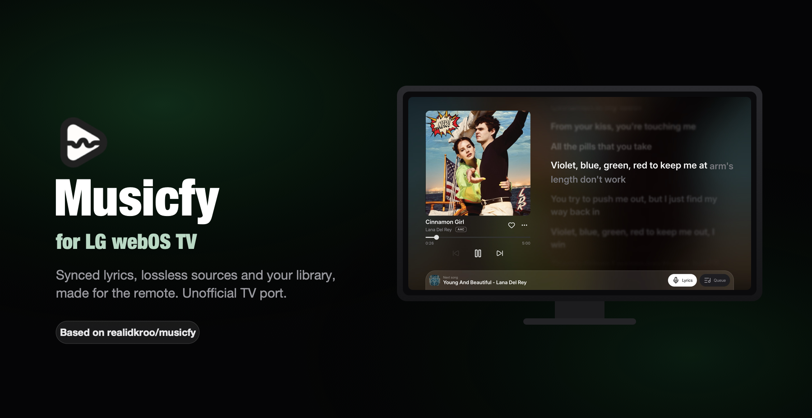

<div align="center">



# Musicfy for LG webOS TV

**A music player for your TV, made for the remote.**
Synced lyrics, your own library and several audio sources on the big screen. Open source, and it does not collect your data.

<p>
  <a href="https://github.com/rigelra15/musicfy/releases/latest"></a>
  <a href="https://github.com/rigelra15/musicfy/actions/workflows/webos-ipk.yml"></a>
  
  <a href="LICENSE"></a>
</p>

</div>

---

> [!IMPORTANT]
> This is an **unofficial** port. Musicfy is the idea and work of [**realidkroo**](https://github.com/realidkroo) and [**realkeichi**](https://github.com/realkeichi), see the [original repository](https://github.com/realidkroo/musicfy). This fork adds the LG webOS TV app. Please report problems with the TV app **here**, not in the original repository, which does not support forks.

> [!NOTE]
> This app is in beta. Parts of it are proven on a real TV and parts are not; see [Honest limits](#honest-limits).

## Contents

- [Credits and origin](#credits-and-origin)
- [What it does](#what-it-does)
- [Install on your TV](#install-on-your-tv)
- [Bring your music over](#bring-your-music-over)
- [Troubleshooting](#troubleshooting)
- [Honest limits](#honest-limits)
- [Build it yourself](#build-it-yourself)
- [Repository layout](#repository-layout)
- [License](#license)
- [Disclaimer](#disclaimer)
- [Thanks](#thanks)

## Credits and origin

Musicfy was made by **realidkroo** and **realkeichi**: the product idea, the design language, the screens and their order, the onboarding, the settings, the audio-source and lyrics-provider contracts and the phone-to-TV transfer idea all come from their Android app. This TV app is an independent port by [Rigel Ramadhani Waloni](https://github.com/rigelra15), written for the web platform (a Preact and TypeScript UI plus a Node 16 service that runs on the TV). It follows the original's behaviour closely but does not copy its Kotlin code, apart from the onboarding icons, which are the Android app's vector drawables, kept in `webos-tv/assets/onboarding-icons/`.

The original app itself is a fork of ViviMusic and builds on Metrolist, RiMusic and ArchiveTune, credited in [Thanks](#thanks). If you like this, please also star the original project.

## What it does

- **Home, Search, Library and Settings** in the phone's style: shelves, mood and genre pages, history, statistics, playlists, likes and pins, all kept on the TV.
- **Player** with the cover, controls and lyrics side by side, five player presets, a blurred cover backdrop, a queue panel, a sleep timer and playback speed.
- **Synced lyrics** from many providers, by line, word or syllable, with grouped backing vocals, translation and readings. Timing is never made up: a source with only line times only gets line times.
- **Audio sources:** YouTube Music (no account), Monochrome (lossless FLAC, no account) and Apple Music through a session sent from your phone.
- **Moving in:** import a backup file or CSV, read a playlist link (Spotify, Apple Music, Deezer, YouTube), or send your collection from the phone over your home network (QR pairing; see [Bring your music over](#bring-your-music-over)).
- **Last.fm and Libre.fm** scrobbling, signed in on the phone side.
- **Indonesian and English**, switchable in Settings and following the TV language on first run.
- **Remote first:** every screen works with the D-pad, OK and Back. The Magic Remote pointer works too: hover chevrons on shelves, and the navbar slides away on the player when you stop using the remote.

Left out on purpose, because they do not make sense on a TV: downloads, offline and local media, the audio lab (equalizer and effects), Discord presence and exporting to a file.

## Install on your TV

You need an LG webOS TV, a computer on the same network, and about fifteen minutes the first time. The app was built and tested on an LG 43UA7550PSA (webOS 25); other models should work but are untested.

The app is installed in **Developer Mode**. That is LG's own way to run apps that are not in the LG Content Store, and it is free.

### 1. Turn on Developer Mode on the TV

1. Create a free LG developer account at [webostv.developer.lge.com](https://webostv.developer.lge.com).
2. On the TV, open the LG Content Store, search for **Developer Mode** and install it.
3. Open **Developer Mode**, sign in with your LG developer account and switch **Dev Mode Status** on. The TV restarts.
4. Open Developer Mode again. Switch **Key Server** on. Keep this screen open: it shows the TV's **IP address** and a **passphrase** you need in step 3.

### 2. Prepare your computer

1. Install [Node.js](https://nodejs.org) 22 or newer.
2. Install LG's webOS command-line tools:

   ```sh
   npm install --global @webos-tools/cli
   ```

### 3. Pair the computer with the TV

Replace `<TV_IP>` with the address shown in the Developer Mode app, and `mytv` with any name you like:

```sh
ares-setup-device --add mytv --info "{'host':'<TV_IP>','port':'9922','username':'prisoner'}"
ares-novacom --device mytv --getkey
```

The second command asks for the **passphrase** from the Developer Mode app. Check that it worked:

```sh
ares-device-info --device mytv
```

### 4. Download and install Musicfy

1. Download the newest `com.musicfy.webos_<version>_all.ipk` from the [Releases page](https://github.com/rigelra15/musicfy/releases/latest). Every release is built from the source in this repository by GitHub Actions; the same file is also attached to each [workflow run](https://github.com/rigelra15/musicfy/actions/workflows/webos-ipk.yml).
2. Install it and start it:

   ```sh
   ares-install --device mytv com.musicfy.webos_<version>_all.ipk
   ares-launch --device mytv com.musicfy.webos
   ```

Musicfy now shows up in the TV's app launcher and opens like any other app. The first run walks you through a short introduction.

### Updating, removing and the Developer Mode session

- **Update:** install the newer `.ipk` the same way. Your library and settings stay on the TV.
- **Remove:** `ares-install --device mytv --remove com.musicfy.webos`.
- **Session:** Developer Mode sessions expire. When Musicfy stops opening, open the Developer Mode app on the TV and extend (renew) the session. This is LG's rule for Developer Mode and cannot be avoided; it is not a Content Store release.

## Bring your music over

The TV keeps its own library, separate from your phone. To bring yours:

- **From the phone, over the home network:** the phone side of the QR transfer (a **Transfer to TV** screen in the Android app) is not part of this branch. Its last version is kept in this repository at the tag [`android-with-transfer`](https://github.com/rigelra15/musicfy/tree/android-with-transfer): check it out and build it with Android Studio. On the TV, open **Settings**, then **Import**, then **Connect phone**, and scan the QR code; both devices must be on the same network. Nothing leaves your home network, and the TV shows what it would add and asks before it imports anything.
- **From a backup or CSV file** or **a playlist link:** use the same Import screen on the TV.
- **Apple Music:** the session is sent from the phone by the same sender (**Settings**, **Modules**, **Apple Music** on the TV). See [Honest limits](#honest-limits) for why.

## Troubleshooting

| Problem | What to check |
| --- | --- |
| `ares-novacom` or `ares-install` cannot connect | The TV and the computer must be on the same network. Check the IP in the Developer Mode app, that **Dev Mode Status** and **Key Server** are on, and that port `9922` is not blocked. |
| The key or passphrase is rejected | The passphrase changes when Developer Mode is switched off and on again. Read it again from the app and run `ares-novacom --getkey` again. |
| The app does not open any more | The Developer Mode session has probably expired. Extend it in the Developer Mode app on the TV. |
| The `ares-*` commands are not found | Reopen the terminal after installing `@webos-tools/cli`, and make sure the global npm folder is in your `PATH`. |
| A song does not play | Sources can be limited or unavailable at any time. Try another song, or change the source order in **Settings**, **Modules**. The in-app **Diagnostics** screen shows what the TV can and cannot do. |
| No lyrics for a song | Lyrics come from third-party services, and some songs have none. Open the player's options to pick another lyrics source. |
| The phone cannot find the TV during a transfer | Both devices must be on the same Wi-Fi. The QR code is valid for a few minutes: start again to get a new one. |

## Honest limits

- **Apple Music cannot be signed in on the TV itself.** Apple's sign-in only runs on `music.apple.com`, which cannot be embedded in another app, and whose token is only valid for the `apple.com` origin. So the session is created on the phone and sent to the TV. Apple Music playback through DRM on the TV is **not proven** yet.
- Not everything has been verified on a real TV. [`webos-tv/VALIDATION.md`](webos-tv/VALIDATION.md) lists what is proven and what is not, and the in-app Diagnostics screen shows the same.
- External providers (lyrics, catalog, audio sources) can be limited or unavailable at any moment.

## Build it yourself

### The TV app

Needs Node 22.12 or newer and the webOS CLI (`@webos-tools/cli`):

```sh
cd webos-tv
npm ci
npm run typecheck
npm test
npm run package:ipk
```

The package ends up in `webos-tv/artifacts/com.musicfy.webos_<version>_all.ipk`. To try the interface in a browser while you work:

```sh
npm run dev -- --port 4177
```

The dev server uses the same service handler as the TV, so it is close to the real thing; it is only a preview and the installed app does not need it. More detail is in [`webos-tv/README.md`](webos-tv/README.md), [`webos-tv/server/API.md`](webos-tv/server/API.md) and [`webos-tv/TRANSFER.md`](webos-tv/TRANSFER.md).

### Releases built by GitHub Actions

The workflow [`webos-ipk.yml`](.github/workflows/webos-ipk.yml) type-checks, tests and packages the IPK on every push to `webos-tv` that touches `webos-tv/`, and on pull requests. The IPK is attached to the run as an artifact. To publish a release, change the version in `webos-tv/public/appinfo.json`, then push a tag that matches it:

```sh
git tag webos-v0.4.0
git push origin webos-v0.4.0
```

The workflow refuses a tag that does not match the app version, builds the IPK and attaches it to a new GitHub release.

## Repository layout

| Folder | What it is |
| --- | --- |
| `webos-tv/` | The TV app: UI (`src/`), the on-TV service (`service/`), tests, packaging scripts and docs |
| `docs/`, `design-plans/` | Plans, specs, the parity matrix and audits of the TV port (they mention the original Android app as the reference) |
| `.github/` | The `webOS TV IPK` workflow, the stale-issue handler and contribution templates |

## License

Licensed under the **GNU General Public License v3.0** ([`LICENSE`](LICENSE)), the same license as the original Musicfy, because this work is derived from it. Anyone who receives the app, including the `.ipk`, is entitled to its source code under the same terms. The names and logo "Musicfy" belong to the original project: this port uses them only to show where it comes from, so if you publish your own build, say clearly that it is unofficial.

Third-party parts keep their own licenses:

| Part | License |
| --- | --- |
| webOSTV.js 1.2.13 (LG) | Apache 2.0, in `webos-tv/public/vendor/webOSTVjs-1.2.13/` |
| Lucide icons | ISC, `webos-tv/public/vendor/lucide-LICENSE.txt` |
| Inter font | SIL Open Font License 1.1, `webos-tv/public/fonts/Inter-LICENSE.txt` |
| shaka-player, preact, iconify-icon, qrcode-generator | their own licenses, see `webos-tv/package.json` |

## Disclaimer

Musicfy is an independent, unofficial project made for personal and educational use. It is provided as is, without warranty of any kind.

- It is not sold and not monetized, and has no commercial intent. Please share this **repository** rather than a copy of the app on a file host.
- Respect the work of artists, musicians and creators. Please subscribe to Apple Music, YouTube Premium or another service you like to support them.
- It is **not affiliated with, endorsed by, or sponsored by** YouTube, YouTube Music, Google, Spotify, Apple, LG, Last.fm, Deezer or any other service it can connect to. All names, logos and brands belong to their owners.
- It does not host, store or distribute any music. Everything is fetched from third-party services when you ask for it, and those services can change or stop working at any time.
- You are responsible for how you use the app, including the terms of the services you connect and the copyright laws where you live.
- Importing or signing in uses your own accounts. Do not share your login data or tokens with anyone.

## Thanks

To **realidkroo** and **realkeichi** for Musicfy, and to the projects it stands on:

- **ViviMusic** by [vivizzz007Z](https://github.com/vivizzz007Z): the base of the original app
- **Metrolist** by [Mostafa Alagamy](https://github.com/mostafaalagamy/Metrolist) and **ArchiveTune** by [Rukamori](https://github.com/rukamori/ArchiveTune): framework, design and architecture inspiration
- **RiMusic / InnerTube** by [fast4x](https://github.com/fast4x/RiMusic): YouTube Music service wrapper
- **Monochrome** by [monochrome-music](https://github.com/monochrome-music/monochrome): the FLAC streams
- **LRCLIB** by [tranxuanthang](https://github.com/tranxuanthang/lrclib), **SimpMusic** by [maxrave-dev](https://github.com/maxrave-dev/SimpMusic), **LyricsPlus** by [Ibra Al Tabian](https://github.com/ibratabian17/LyricsPlus) and **Better Lyrics API** by [Boidushya](https://github.com/better-lyrics/api): lyrics
- **LG** for webOSTV.js and the webOS CLI, and the **Lucide** and **Inter** projects for icons and the typeface
